# CTA Ridership Diagrams

Diagrams of PROJECT_PLAN.md in Mermaid, drawn to the IT 432 rubrics. They render on GitHub and in VS Code's Markdown preview (a Mermaid extension may be needed). Open `cta-diagrams.html` in a browser to see them all rendered.

| Phase | Diagrams |
|---|---|
| 1. Plain Python | 8 Activity, 9 Design class |
| 2. pandas + EDA | 10 DFD context, 11 DFD level 0 |
| 3. SQL | 12 ER, 13 Domain model class |
| 4. S3 | 4 Data lake layout |
| 5. Terraform | 5 Module dependencies |
| 6. Lambda pipeline | 15 Sequence, 14 Design class |
| 7. Model + dashboard | 16 Component, 17 Design class |
| 8. CI/CD | 18 Activity |
| Overall | 3 AWS architecture, 7 Use case, 1 Roadmap, 2 Growth, 6 Open decisions |

# Part 1: Big picture

## 1. Phase roadmap

*Gantt chart (not UML).* Eight phases at about 10 hours a week. Bar lengths use the midpoint of each phase's hour estimate, so dates are approximate. Phases 1–3 alone make a portfolio project.

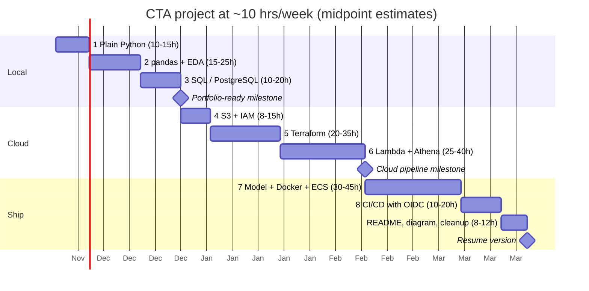

## 2. How the system grows

*Overview (not UML).* Each phase replaces one piece of the previous one. Functions written early, such as fetch_*, clean_*, and s3_io, are reused later instead of rewritten.

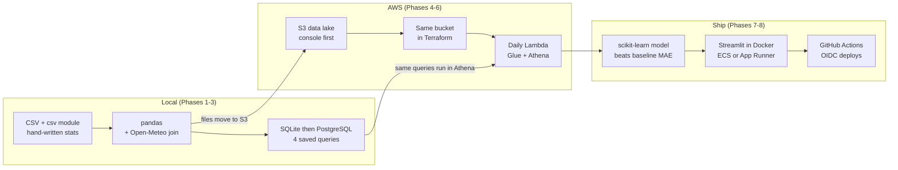

## 3. Overall · AWS architecture

*Architecture diagram (not UML).* The finished system on one page, and the diagram for your README. Everything inside the AWS box is created by Terraform and deployed from GitHub Actions without stored access keys.

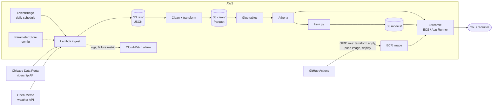

## 4. Phase 4 · Data lake layout

*Folder layout (not UML).* Raw API responses are partitioned by ingest date, clean Parquet by year and month, and models are versioned by training date.

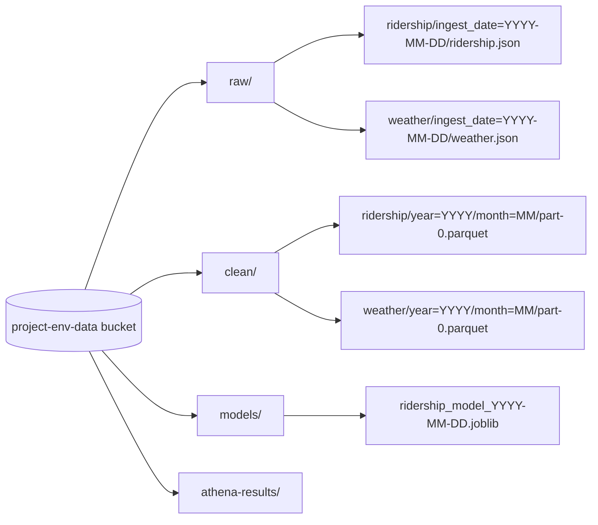

## 5. Phase 5 · Terraform module dependencies

*Module diagram (not UML).* Dev and prod call the same modules with different variables. Only storage is built in Phase 5; the other modules arrive with their phases.

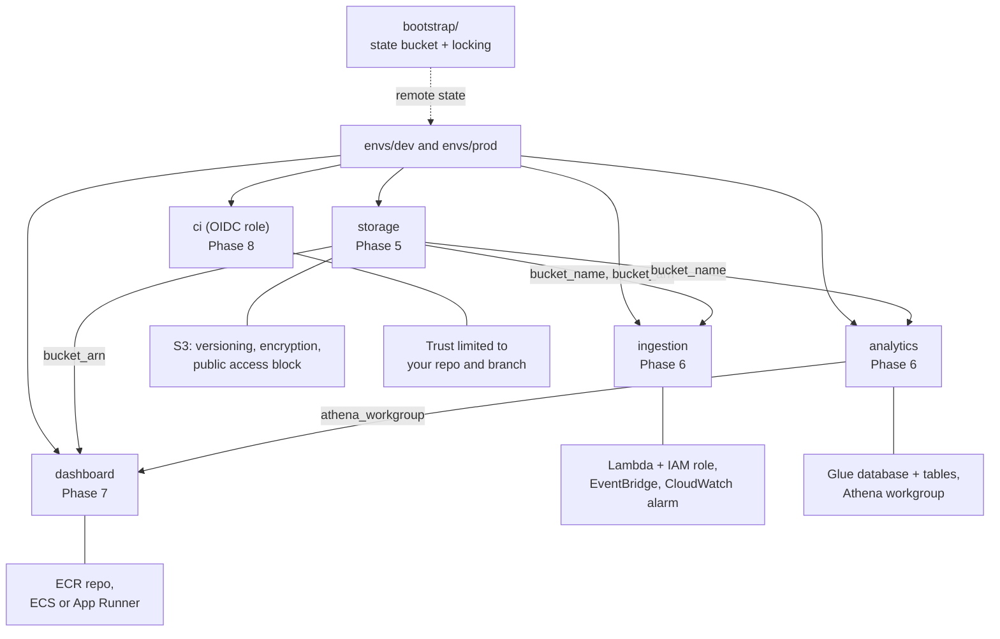

## 6. Open decisions, by when you hit them

*Checklist map (not UML).* Choices the plan leaves to you, placed in the phase where each one comes up.

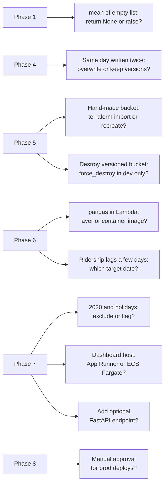

# Part 2: UML by phase

## 7. Whole system · Use case diagram

*UML use case diagram.* Actors outside the automation boundary and the use cases inside it. Ingest Daily Data always includes Clean Source Data; Backfill Historical Data extends it when a past date is passed in; Train Ridership Model always includes Evaluate Model Against Baseline. Mermaid has no actor or ellipse shapes, so actors are boxes marked «actor» and use cases are rounded shapes.

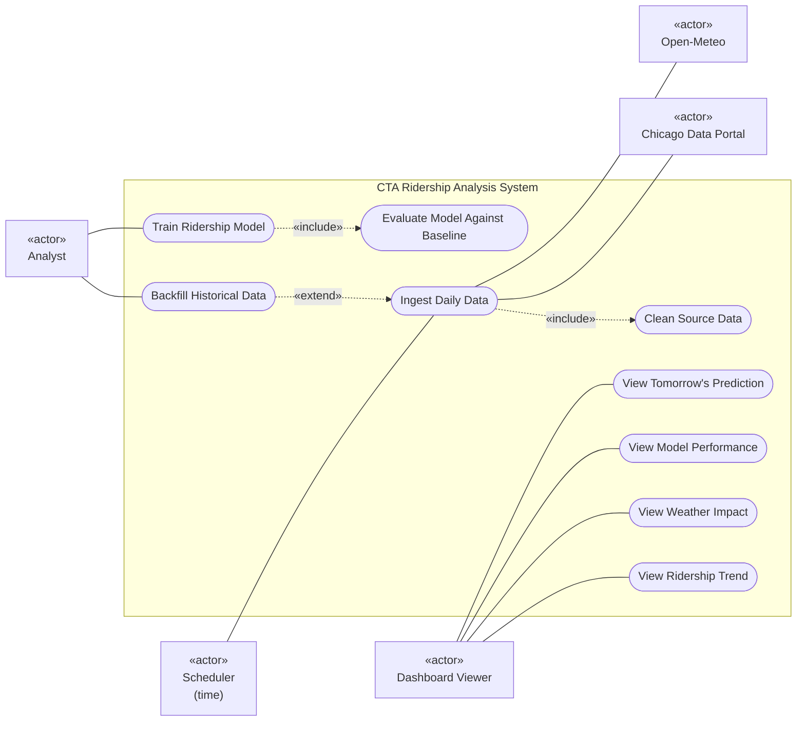

## 8. Phase 1 · Activity diagram: clean and summarize the CSV

*UML activity diagram.* Swimlanes for the Analyst and the script. Every decision node has a matching merge node, the three summaries run between a fork and a join, and ridership.csv and the cleaning report are object nodes.

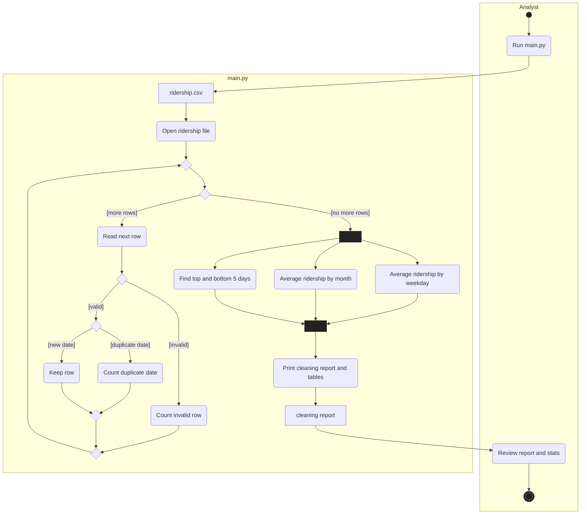

## 9. Phase 1 · Design class diagram: main.py

*UML design class diagram.* main.py drawn as a «module» class: every function with typed parameters and a return type. The dashed arrow shows the standard-library check your mean and median must match.

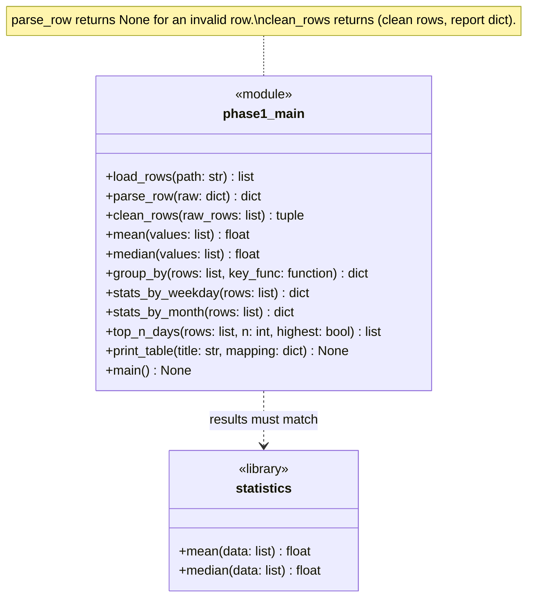

## 10. Phase 2 · DFD context diagram

*Data flow diagram (Gane and Sarson).* The whole Phase 2 system as process 0, with its sources and sinks. No data stores appear at the context level.

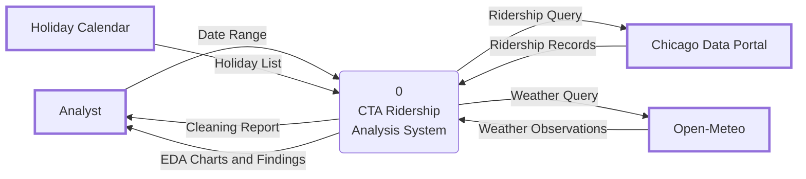

## 11. Phase 2 · DFD level 0 diagram

*Data flow diagram (Gane and Sarson).* Every context flow appears here. Processes are numbered verb phrases, data stores are numbered noun phrases (D1–D3), and data only enters or leaves a store through a process. Mermaid has no open-ended rectangle, so stores use the double-sided box.

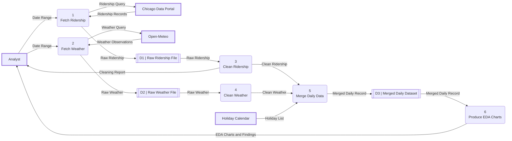

**Data dictionary**

- **Date Range** = Start_Date + End_Date
- **Ridership Query** = Dataset_ID + Start_Date + End_Date
- **Ridership Records** = 1{Service_Date + Day_Type + Bus_Rides + Rail_Rides + Total_Rides}N
- **Raw Ridership** = Ingest_Date + 1{Service_Date + Day_Type + Bus_Rides + Rail_Rides + Total_Rides}N
- **Weather Query** = Latitude + Longitude + Start_Date + End_Date + Daily_Variables
- **Weather Observations** = 1{Weather_Date + Temp_Max_C + Temp_Min_C + Precipitation_mm + Snowfall_cm}N
- **Raw Weather** = Ingest_Date + 1{Weather_Date + Temp_Max_C + Temp_Min_C + Precipitation_mm + Snowfall_cm}N
- **Clean Ridership** = 1{Service_Date + Day_Type + Bus_Rides + Rail_Rides + Total_Rides}N
- **Clean Weather** = 1{Weather_Date + Temp_Max_C + Temp_Min_C + Precipitation_mm + Snowfall_cm}N
- **Holiday List** = 1{Holiday_Date + Holiday_Name}N
- **Cleaning Report** = Rows_Loaded + Rows_Invalid + Rows_Duplicate + Rows_Kept
- **Merged Daily Record** = Service_Date + Total_Rides + Bus_Rides + Rail_Rides + Temp_Max_C + Temp_Min_C + Precipitation_mm + Snowfall_cm + Weekday + Month + Is_Weekend + Is_Holiday
- **EDA Charts and Findings** = 1{Chart_Title + Chart_Image + Finding_Sentence}N

## 12. Phase 3 · ER diagram

*Entity-relationship diagram.* The three SQL tables, keyed by date so loads can be upserts. Every service day has at most one weather row and at most one holiday.

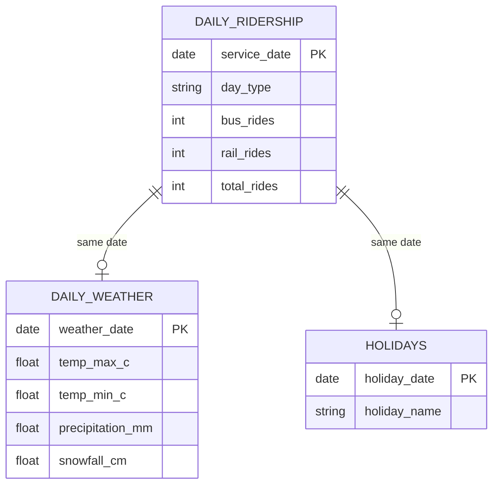

## 13. Phase 3 · Domain model class diagram

*UML domain model class diagram.* The problem-domain classes with {key} identifiers, attributes, named associations, and multiplicities. RidershipCount is abstract with a {disjoint, complete} generalization, IngestRun is a whole made of RawFiles, and Prediction is the association class on Model predicts ServiceDay. Mermaid cannot draw the dashed line to an association, so Prediction is linked to both ends with a note.

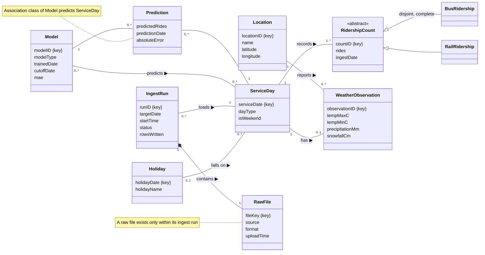

## 14. Phases 2–6 · Design class diagram: pipeline modules

*UML design class diagram.* The data modules and the Lambda handler with full method signatures. Arrows are navigation visibility: the handler calls ingest, cleaning, and s3_io instead of copying their code.

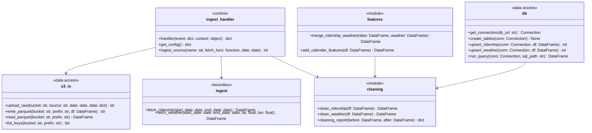

## 15. Phase 6 · Multilayer sequence diagram: daily ingest

*UML sequence diagram.* Object lifelines (name:Class), messages written as returnValue := message(parameters), a dashed return after each synchronous call, alt frames whose guard conditions Mermaid shows in brackets, «create» for each new raw file, and assumptions in a note.

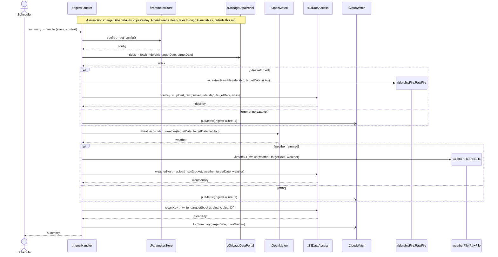

## 16. Phase 7 · Component diagram

*Component diagram.* How the training job, the model file, the container, and the dashboard connect. The course rubrics don't cover component diagrams, so this uses «component» and «artifact» labels to stand in for UML component symbols.

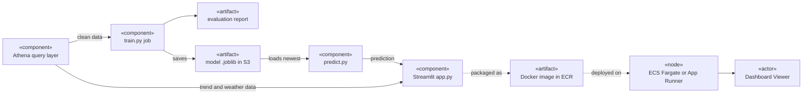

## 17. Phase 7 · Design class diagram: model and dashboard

*UML design class diagram.* Training, prediction, and dashboard code with full signatures. Every model is compared with the same-as-7-days-ago baseline before it is saved.

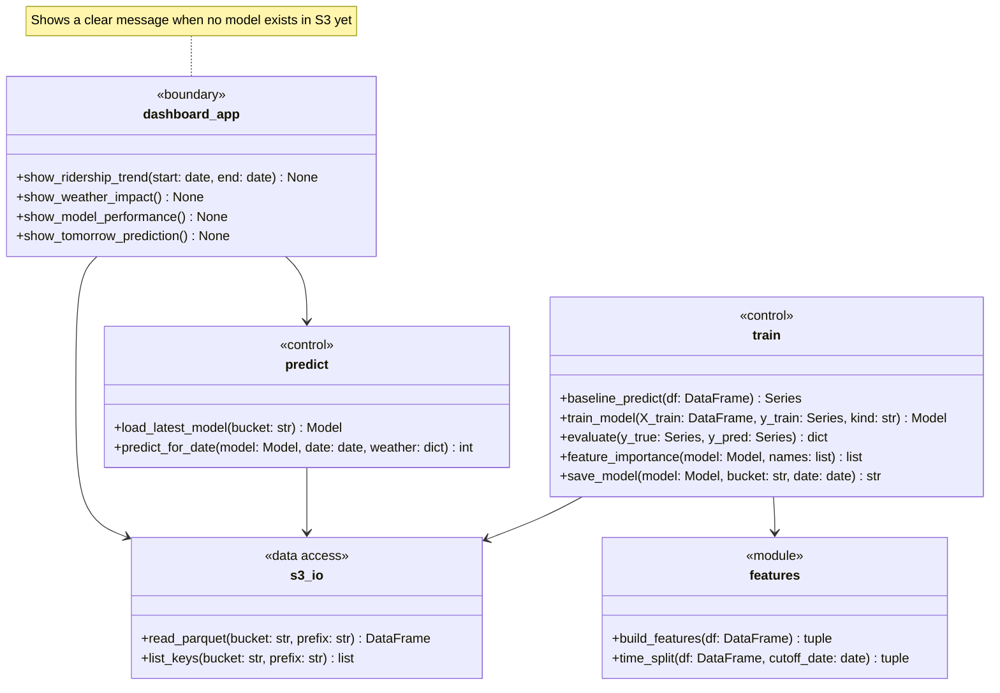

## 18. Phase 8 · Activity diagram: CI/CD

*UML activity diagram.* Swimlanes for the Developer, GitHub Actions, and AWS. A pull request runs the checks between a fork and a join; failed checks or a rejected review loop back through merge nodes; only a merge to main reaches AWS.

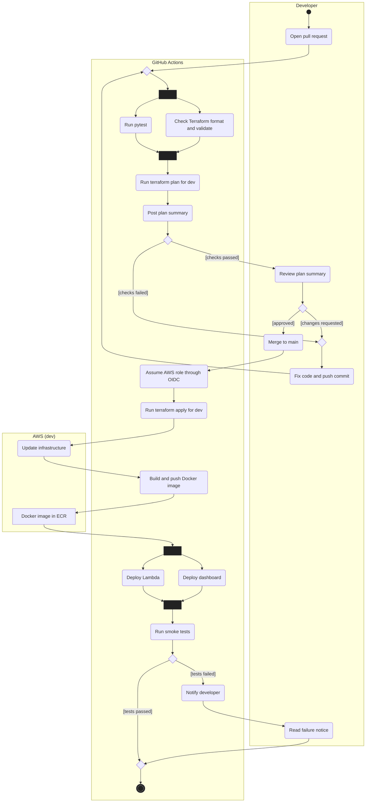
