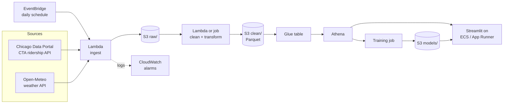
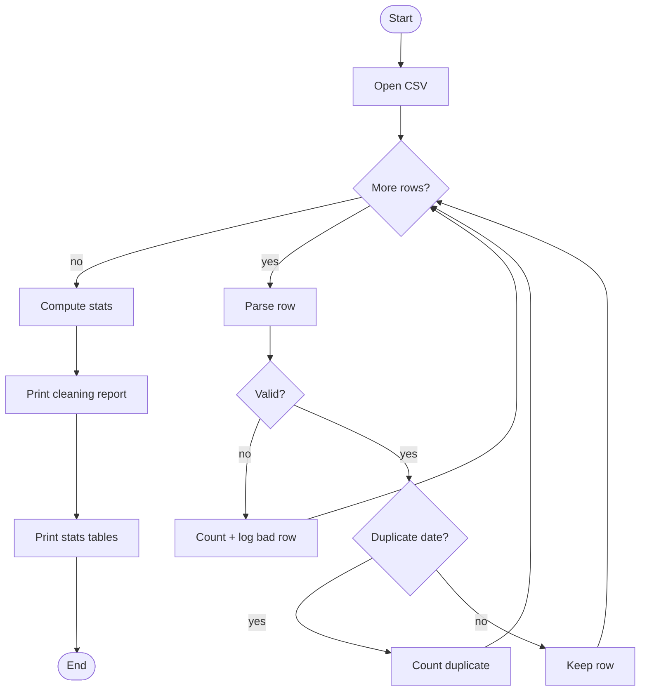
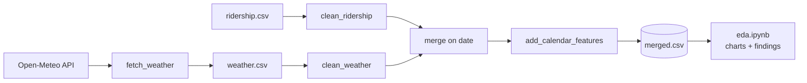
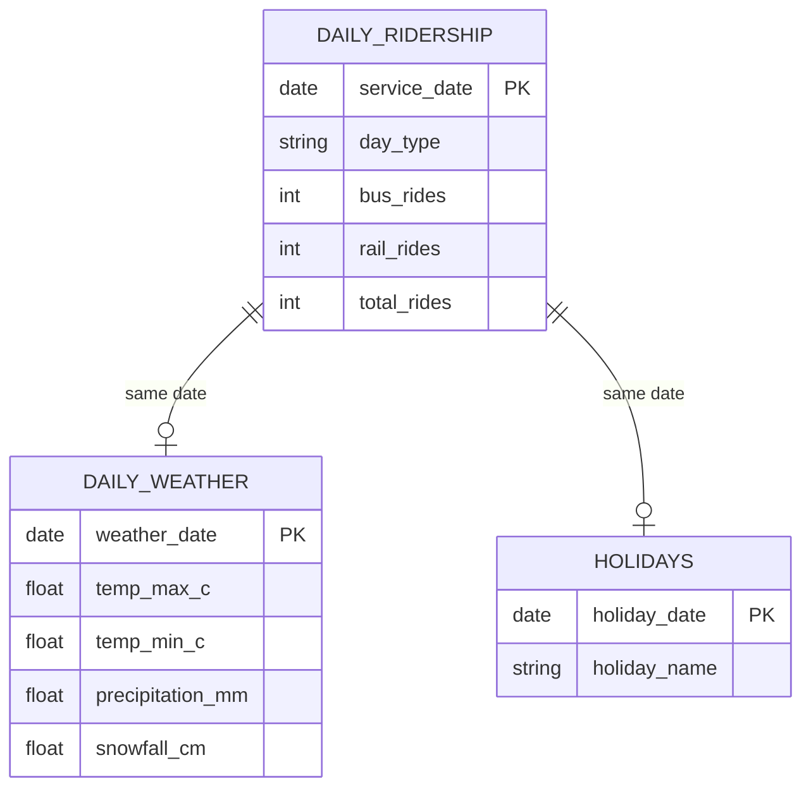
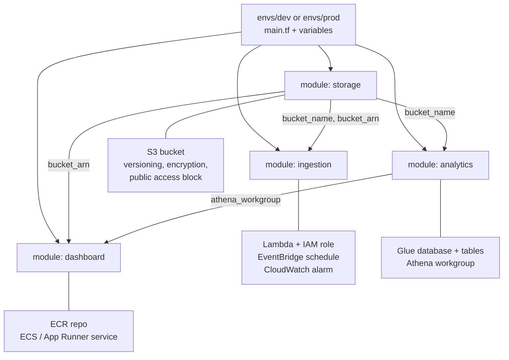
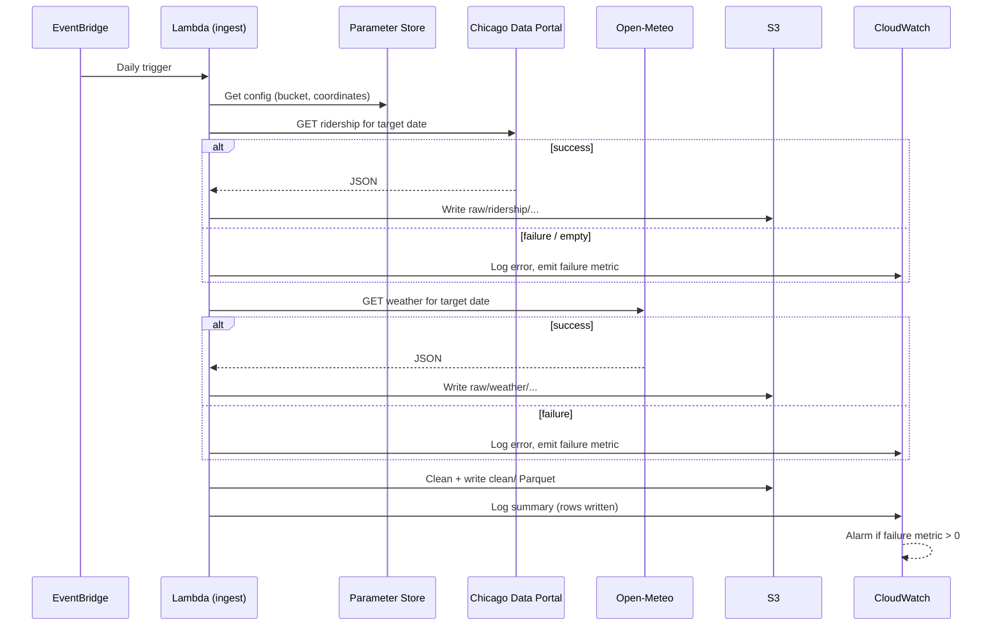
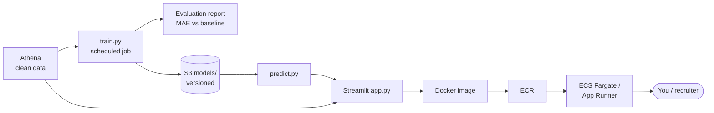
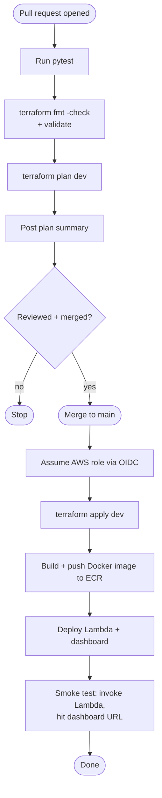

# CTA Ridership & Weather Project — Project Plan

A beginner-friendly data science project that scales into a full cloud data pipeline on AWS, managed with Terraform. Built **by hand** to rebuild coding fluency: this plan gives structure (files, functions, inputs/outputs, diagrams, checks) but **no logic** — that part is yours to write.

---

## 1. What we decided

| Decision | Choice |
|---|---|
| Core question | How do weather, day of week, and holidays affect daily CTA ridership? |
| Ridership data | Chicago Data Portal — CTA daily boarding totals (bus + rail), CSV or API |
| Weather data | Open-Meteo historical weather API (free, no key) |
| Language | Python (terminal first, no GUI until the dashboard) |
| Local database | SQLite → PostgreSQL |
| Cloud | AWS — S3, IAM, Lambda, EventBridge, Glue, Athena, CloudWatch, Secrets Manager / Parameter Store, ECR, ECS Fargate or App Runner |
| Infrastructure as code | Terraform (modules, remote state in S3 with locking, dev/prod environments) |
| ML | scikit-learn: baseline → linear regression → random forest, time-based split, MAE |
| Dashboard | Streamlit (optional FastAPI prediction endpoint) |
| CI/CD | GitHub Actions with OIDC auth to AWS (no stored access keys) |
| Testing | pytest |
| Working style | Outlines + diagrams from this plan; all logic written by hand |
| Code style | Plain `for` loops instead of list comprehensions |

### Time estimate

Roughly **135–220 hours** with this outline (about 150–250 without). At ~10 hrs/week:

- **~Month 1:** Phases 1–3 done → already a portfolio project
- **~Month 3:** Data in S3, pipeline on Lambda, all in Terraform
- **~Months 4–6:** Model, dashboard, CI/CD → full resume version

| Phase | Est. hours |
|---|---|
| 1. Plain Python | 10–15 |
| 2. pandas + EDA | 15–25 |
| 3. SQL / PostgreSQL | 10–20 |
| 4. S3 + IAM | 8–15 |
| 5. Terraform | 20–35 |
| 6. Lambda pipeline + Athena | 25–40 |
| 7. Model + Docker + ECS | 30–45 |
| 8. CI/CD with OIDC | 10–20 |
| README, diagram, cleanup | 8–12 |

### Cost guardrails (do these before creating anything in AWS)

- [ ] Create an **AWS Budget** with an email alert (e.g. $5)
- [ ] Never use the root account for daily work; enable MFA
- [ ] Prefer **Athena over RDS** (RDS, NAT gateways, and always-on ECS tasks are the expensive parts)
- [ ] `terraform destroy` the dev environment when not in use

---

## 2. Overall architecture



## 3. Repository layout (target)

```
cta-ridership/
├── README.md
├── PROJECT_PLAN.md
├── requirements.txt
├── data/
│   ├── raw/                # gitignored
│   └── clean/              # gitignored
├── src/
│   ├── phase1/             # plain-Python version
│   ├── cleaning.py
│   ├── features.py
│   ├── ingest.py
│   ├── db.py
│   ├── s3_io.py
│   ├── train.py
│   └── predict.py
├── notebooks/
│   └── eda.ipynb
├── sql/
│   ├── schema.sql
│   └── queries/
├── lambda/
│   └── ingest_handler.py
├── dashboard/
│   ├── app.py
│   └── Dockerfile
├── infra/
│   ├── modules/
│   │   ├── storage/
│   │   ├── ingestion/
│   │   ├── analytics/
│   │   └── dashboard/
│   └── envs/
│       ├── dev/
│       └── prod/
├── tests/
└── .github/workflows/
```

---

## Phase 1 — Plain Python in the terminal

**Goal:** Load the ridership CSV, clean it, and compute stats with only the standard library (`csv`, `datetime`). No pandas.

### Activity diagram



### Files & functions

`src/phase1/main.py`

| Function | Input | Output | Purpose |
|---|---|---|---|
| `load_rows(path)` | file path (str) | list of dicts (raw strings) | Read the CSV with `csv.DictReader` |
| `parse_row(raw)` | one raw dict | clean dict **or** `None` | Convert date to `datetime.date`, ridership to `int`; return `None` if invalid |
| `clean_rows(raw_rows)` | list of raw dicts | (clean rows, report dict) | Apply `parse_row`, drop bad rows and duplicate dates, count what happened |
| `mean(values)` | list of numbers | float | Written by hand |
| `median(values)` | list of numbers | float | Written by hand (sort a copy) |
| `group_by(rows, key_func)` | rows, function that returns a group key | dict: key → list of rows | The heart of "group by", by hand |
| `stats_by_weekday(rows)` | clean rows | dict: weekday → mean ridership | Uses `group_by` + `mean` |
| `stats_by_month(rows)` | clean rows | dict: month → mean ridership | Same pattern |
| `top_n_days(rows, n, highest)` | rows, int, bool | list of rows | Busiest / quietest days |
| `print_table(title, mapping)` | str, dict | nothing | Aligned output with f-string padding |
| `main()` | — | — | Wires it all together |

### Done when
- [ ] Prints a cleaning report: `Loaded X rows, dropped Y invalid, Z duplicates`
- [ ] Prints average ridership by weekday and by month in aligned columns
- [ ] Prints top 5 busiest and quietest days
- [ ] Your `mean`/`median` match Python's `statistics` module on the same data

### Edge cases
- Empty file / header only
- Ridership blank, negative, or non-numeric
- Dates in an unexpected format
- `mean([])` → decide: return `None` or raise?
- Even vs. odd count in `median`

---

## Phase 2 — pandas, weather join, and EDA

**Goal:** Redo Phase 1 in pandas, fetch weather, join on date, explore and chart.

### Data flow diagram



### Files & functions

`src/cleaning.py`

| Function | Input | Output | Purpose |
|---|---|---|---|
| `clean_ridership(df)` | raw DataFrame | clean DataFrame | Types, drop invalid, drop duplicate dates, sort |
| `clean_weather(df)` | raw DataFrame | clean DataFrame | Types, units, handle missing values |
| `cleaning_report(before, after)` | two DataFrames | dict | Rows in / out / dropped |

`src/ingest.py`

| Function | Input | Output | Purpose |
|---|---|---|---|
| `fetch_weather(start_date, end_date, lat, lon)` | dates, coordinates | DataFrame | Daily temp, precipitation, snowfall from Open-Meteo |
| `fetch_ridership(start_date, end_date)` | dates | DataFrame | Pull from the Chicago Data Portal API (instead of a manual CSV download) |

`src/features.py`

| Function | Input | Output | Purpose |
|---|---|---|---|
| `merge_ridership_weather(rides, weather)` | 2 DataFrames | DataFrame | Join on date; report unmatched dates |
| `add_calendar_features(df)` | DataFrame | DataFrame | Weekday, month, is_weekend, is_holiday |

`notebooks/eda.ipynb` — questions to answer with charts:
1. Ridership over the full time range (mark the 2020 drop and recovery)
2. Average ridership by weekday
3. Rainy/snowy days vs. dry days
4. Temperature vs. ridership (scatter)
5. Holidays vs. normal days

### Done when
- [ ] pandas results match your Phase 1 numbers
- [ ] One merged dataset with ridership + weather + calendar features
- [ ] At least 5 charts, each with a one-sentence written finding

### Edge cases
- Weather API timeout / rate limit → retry or fail clearly
- Dates present in one dataset but not the other
- Time zones (make sure "a day" means the same thing in both)

---

## Phase 3 — SQL (SQLite → PostgreSQL)

**Goal:** Store clean data in a relational database and answer the analysis questions in SQL.

### ER diagram



### Files & functions

`sql/schema.sql` — `CREATE TABLE` statements for the three tables above.

`src/db.py`

| Function | Input | Output | Purpose |
|---|---|---|---|
| `get_connection(db_url)` | connection string | connection | SQLite first, then PostgreSQL |
| `create_tables(conn)` | connection | nothing | Run `schema.sql` |
| `upsert_ridership(conn, df)` | connection, DataFrame | rows written (int) | Insert or update by date |
| `upsert_weather(conn, df)` | connection, DataFrame | rows written (int) | Same |
| `run_query(conn, sql_path)` | connection, file path | DataFrame | Run a saved query |

`sql/queries/` — write these yourself:
- `avg_by_weekday.sql` — GROUP BY
- `rolling_7day.sql` — window function (`AVG() OVER`)
- `weather_impact.sql` — JOIN + CASE (rain / no rain buckets)
- `yoy_change.sql` — year-over-year by month (`LAG`)

### Done when
- [ ] Re-running the load doesn't create duplicates (upsert works)
- [ ] All 4 queries match your pandas results
- [ ] Same code works against SQLite and PostgreSQL by changing only the connection string

### Edge cases
- Loading the same day twice
- NULL weather for a date
- SQLite vs. PostgreSQL date-function differences

---

## Phase 4 — Move storage to AWS (S3 + IAM)

**Goal:** Use S3 as a data lake. Build it **by hand in the console first** so you understand it, then codify it in Phase 5.

### Data lake layout

```
s3://<project>-<env>-data/
├── raw/
│   ├── ridership/ingest_date=2026-11-17/ridership.json
│   └── weather/ingest_date=2026-11-17/weather.json
├── clean/
│   ├── ridership/year=2026/month=11/part-0.parquet
│   └── weather/year=2026/month=11/part-0.parquet
├── models/
│   └── ridership_model_2026-11-17.joblib
└── athena-results/
```

### Files & functions

`src/s3_io.py`

| Function | Input | Output | Purpose |
|---|---|---|---|
| `upload_raw(bucket, source, date, data)` | bucket, "ridership"/"weather", date, JSON | S3 key | Write untouched API response |
| `write_parquet(bucket, prefix, df)` | bucket, prefix, DataFrame | S3 key | Write partitioned Parquet |
| `read_parquet(bucket, prefix)` | bucket, prefix | DataFrame | Read back for training / checks |
| `list_keys(bucket, prefix)` | bucket, prefix | list of str | See what's there |

### IAM
- One role/user for **your scripts** — read/write to this bucket only
- Bucket: block all public access, versioning on, default encryption on

### Done when
- [ ] Historical data uploaded to `raw/` and `clean/`
- [ ] Phase 2 scripts can read from and write to S3 instead of local files
- [ ] Your script's credentials **cannot** touch any other bucket (test it)

### Edge cases
- Overwriting the same day's file (decide: overwrite or keep versions?)
- AccessDenied errors — read them carefully, they name the missing permission

---

## Phase 5 — Terraform

**Goal:** Recreate everything from Phase 4 as code, then grow it in later phases.

### Module diagram



### Files

| File | What goes in it |
|---|---|
| `infra/bootstrap/` | One-time: S3 bucket for Terraform state (created once, separately) |
| `infra/envs/dev/backend.tf` | Remote state in S3 with state locking |
| `infra/envs/dev/main.tf` | Calls each module with dev values |
| `infra/envs/dev/variables.tf` / `terraform.tfvars` | Region, project name, env name |
| `infra/modules/<name>/main.tf` | Resources for that module |
| `infra/modules/<name>/variables.tf` | Module inputs |
| `infra/modules/<name>/outputs.tf` | Values other modules need |

**Phase 5 scope:** only the `storage` module. Add `ingestion`, `analytics`, `dashboard` in Phases 6–7.

### Done when
- [ ] `terraform plan` shows no changes after `apply` (no drift)
- [ ] You can `terraform destroy` and `apply` and get the same bucket setup back
- [ ] `dev` and `prod` produce different bucket names from the same module
- [ ] State is remote; nothing sensitive is committed (`.terraform/`, `*.tfstate`, `*.tfvars` with secrets in `.gitignore`)

### Edge cases
- Import the bucket you made by hand (`terraform import`) **or** delete it and let Terraform create it — try importing once to learn it
- Bucket names are globally unique — build them from variables
- `destroy` fails on non-empty versioned buckets — decide how to handle (`force_destroy` in dev only)

---

## Phase 6 — Serverless ingestion pipeline (Lambda + EventBridge + Athena)

**Goal:** The daily fetch runs itself in the cloud.

### Sequence diagram



### Files & functions

`lambda/ingest_handler.py`

| Function | Input | Output | Purpose |
|---|---|---|---|
| `handler(event, context)` | Lambda event | dict summary | Entry point; reads target date from event or defaults to "yesterday" |
| `get_config()` | — | dict | Bucket name, lat/lon from env vars / Parameter Store |
| `ingest_source(name, fetch_func, date)` | str, function, date | rows written (int) | Fetch → raw → clean, for one source |

Reuse `fetch_*` from `ingest.py`, `clean_*` from `cleaning.py`, and `s3_io.py` — don't copy-paste.

**Terraform (`ingestion` + `analytics` modules):** Lambda function, its IAM role (least privilege), EventBridge rule, CloudWatch log group + alarm, Glue database/tables over `clean/`, Athena workgroup with results going to `athena-results/`.

### Done when
- [ ] Lambda runs on schedule and new data appears in S3 daily
- [ ] Running it twice for the same date doesn't create duplicates (idempotent)
- [ ] A forced failure triggers the CloudWatch alarm
- [ ] Your Phase 3 queries run in Athena against the Parquet files
- [ ] Backfill works: invoke with a past date in the event

### Edge cases
- pandas is too large for a plain Lambda zip → use a Lambda layer or a container image
- Ridership data often lags a few days — the target date may have no data yet
- Lambda timeout (raise it from the default)

---

## Phase 7 — Model training + dashboard on AWS

**Goal:** Predict daily ridership and show it in a deployed dashboard.

### Component diagram



### Files & functions

`src/features.py` (extend)

| Function | Input | Output | Purpose |
|---|---|---|---|
| `build_features(df)` | merged DataFrame | (X, y) | Weekday, month, holiday, temps, precipitation, lag features (e.g. ridership 7 days ago) |
| `time_split(df, cutoff_date)` | DataFrame, date | (train, test) | **Time-based** split, never random |

`src/train.py`

| Function | Input | Output | Purpose |
|---|---|---|---|
| `baseline_predict(df)` | DataFrame | predictions | "Same as 7 days ago" |
| `train_model(X_train, y_train, kind)` | data, "linear"/"forest" | fitted model | scikit-learn |
| `evaluate(y_true, y_pred)` | arrays | dict (MAE, maybe RMSE) | Compare every model to the baseline |
| `feature_importance(model, names)` | model, list | sorted list | What matters most |
| `save_model(model, bucket, date)` | model, bucket, date | S3 key | Versioned by date |

`src/predict.py`

| Function | Input | Output | Purpose |
|---|---|---|---|
| `load_latest_model(bucket)` | bucket | model | Newest file in `models/` |
| `predict_for_date(model, date, weather)` | model, date, forecast | int | Predicted riders |

`dashboard/app.py` — pages/sections:
1. Ridership trend (with date range picker)
2. Weather impact
3. Model performance (MAE vs. baseline)
4. Tomorrow's predicted ridership

`dashboard/Dockerfile` — build and run locally first, then push to ECR.

**Terraform (`dashboard` module):** ECR repo, App Runner service **or** ECS cluster + task + service, IAM role allowing read from S3/Athena.

### Done when
- [ ] Best model beats the baseline MAE (write down both numbers — they go on your resume)
- [ ] Dashboard runs locally in Docker
- [ ] Dashboard runs on AWS from Terraform
- [ ] A fresh model can be trained and picked up without changing dashboard code

### Edge cases
- Holidays and the 2020 period distort training — decide whether to exclude or flag them
- No model in S3 yet → dashboard shows a clear message instead of crashing
- Container can't reach S3 → check the task role, not your laptop credentials

---

## Phase 8 — CI/CD with GitHub Actions

**Goal:** Tests and infrastructure changes run automatically.

### Activity diagram



### Files

| File | Purpose |
|---|---|
| `.github/workflows/ci.yml` | On pull request: pytest, terraform fmt/validate/plan |
| `.github/workflows/deploy.yml` | On merge to main: OIDC auth, apply, build, deploy |
| `infra/modules/ci/` (or in bootstrap) | GitHub OIDC provider + IAM role limited to your repo |
| `tests/test_cleaning.py` | Bad rows, duplicates, empty input |
| `tests/test_features.py` | Calendar features, time split never leaks future data |
| `tests/test_stats.py` | Your hand-written mean/median/group_by |

### Done when
- [ ] A failing test blocks the merge
- [ ] No AWS access keys stored in GitHub secrets
- [ ] Merging to main deploys without you touching the console
- [ ] (Optional) `prod` deploy requires manual approval

### Edge cases
- OIDC role trust policy too broad → restrict to your repo and branch
- Two workflows applying at the same time → state locking should stop it; verify

---

## Final deliverables checklist

- [ ] README with: question, architecture diagram, results (MAE vs. baseline), screenshots, how to run
- [ ] Clean commit history on GitHub
- [ ] `terraform destroy` works for dev
- [ ] Resume bullet filled in with real numbers:

> Built a serverless data pipeline on AWS (Lambda, EventBridge, S3, Athena) that ingests daily CTA ridership and weather data, with all infrastructure defined in Terraform and deployed via GitHub Actions. Trained a scikit-learn model predicting daily ridership (MAE of **X** vs. **Y** baseline) and served results through a containerized Streamlit dashboard on ECS.

## Rules for doing it by hand

- Turn off AI autocomplete (Copilot etc.) in your editor for this project
- Use official docs: Python, pandas, boto3, Terraform AWS provider, AWS service docs
- Plain `for` loops instead of list comprehensions
- Write it yourself first; only look things up when you're stuck, and look up the concept, not the solution
